<picture>
  <source media="(prefers-color-scheme: dark)" srcset="assets/banner.svg" />
  <source media="(prefers-color-scheme: light)" srcset="assets/banner-light.svg" />
  
</picture>

  <strong>Information Systems @ Universitas Brawijaya · Business Intelligence · Web Development</strong>

  
  
  

---

## About

Information Systems student at the Faculty of Computer Science, Universitas Brawijaya, focused on business intelligence and web development. I build analytics dashboards and web applications that turn business questions into clear, usable tools.

- 🏆 **1st place, National Business Plan Competition**, Youth Economics Science Competition (YES-C) 2026
- 🔭 Building data-driven products across web, analytics, and mobile
- 🤝 Open to internships and collaboration in BI, data analytics, and web development

## Featured Projects

| Project | What it does | Stack |
|---|---|---|
| **[JALA Fraud Analytics](https://github.com/Yance30/Jala)** · [demo](https://jala-fraud.streamlit.app/) | Prototype for BPJS Kesehatan Healthkathon 2026. Prioritizes health-insurance claims for audit using graph features across facilities, doctors, and patients. On 17,431 synthetic claims at a fixed audit capacity, it caught 436 fraudulent claims vs. 91 for a rule-based baseline. | Python · Streamlit · NetworkX · scikit-learn |
| **[FoodSave](https://github.com/Yance30/foodsave)** · [demo](https://foodsave.infinityfree.me) | Platform that routes surplus food from shops, caterers, and canteens in Malang to recipients before it is wasted, and tracks food saved and CO₂e avoided. Three roles, provider verification, maps, and automated tests. | Laravel 12 · PHP · Tailwind CSS · Alpine.js |
| **[BI Dashboard](https://github.com/Yance30/Big-Data)** | CSV-to-MySQL ETL pipeline with linear-regression forecasting and interactive Plotly visualizations. | Python · Streamlit · MySQL · scikit-learn |
| **[Tandur](https://github.com/Yance30/Tandur)** · [demo](https://tandur-psi.vercel.app/) | Web prototype that digitizes the *akad salam* (Islamic forward-sale) workflow for Islamic cooperatives. | JavaScript · HTML · CSS |

## Tech Stack

- **Data & BI:** Python, Pandas, scikit-learn, NetworkX, Streamlit, Plotly, SQL, MySQL
- **Web:** Laravel, PHP, JavaScript, TypeScript, React, Tailwind CSS
- **Mobile:** Kotlin, Jetpack Compose
- **Tools:** Git, GitHub Actions, Figma, Vercel

---

  Open to internships and collaboration on BI, data, and web projects —
  <a href="mailto:yansgrouppansi@gmail.com">email me</a> or connect on
  <a href="https://www.linkedin.com/in/yanceadhynatapanjaitan/">LinkedIn</a>.

<picture>
  <source media="(prefers-color-scheme: dark)" srcset="assets/footer.svg" />
  <source media="(prefers-color-scheme: light)" srcset="assets/footer-light.svg" />
  
</picture>
