<picture>
  <source media="(prefers-color-scheme: dark)" srcset="assets/banner.svg" />
  <source media="(prefers-color-scheme: light)" srcset="assets/banner-light.svg" />
  
</picture>

  <strong>Information Systems @ Universitas Brawijaya · Business Intelligence · Web Development</strong>

  
  
  

---

## About

Information Systems student at the Faculty of Computer Science, Universitas Brawijaya, focused on business intelligence and web development. I build analytics dashboards and web applications that turn business questions into clear, usable tools. I'm also open to internships and collaboration in BI, data analytics, and web development.

## Featured Projects

  <a href="https://foodsave.infinityfree.me"><picture>
    <source media="(prefers-color-scheme: dark)" srcset="assets/cards/foodsave-dark.svg" />
    <source media="(prefers-color-scheme: light)" srcset="assets/cards/foodsave-light.svg" />
    
  </picture></a>
  <a href="https://jala-fraud.streamlit.app/"><picture>
    <source media="(prefers-color-scheme: dark)" srcset="assets/cards/jala-dark.svg" />
    <source media="(prefers-color-scheme: light)" srcset="assets/cards/jala-light.svg" />
    
  </picture></a>
  <a href="https://civicpulse.my.id/"><picture>
    <source media="(prefers-color-scheme: dark)" srcset="assets/cards/civicpulse-dark.svg" />
    <source media="(prefers-color-scheme: light)" srcset="assets/cards/civicpulse-light.svg" />
    
  </picture></a>
  <a href="https://yance30.github.io/kedai-rakdjat/"><picture>
    <source media="(prefers-color-scheme: dark)" srcset="assets/cards/kedai-dark.svg" />
    <source media="(prefers-color-scheme: light)" srcset="assets/cards/kedai-light.svg" />
    
  </picture></a>
  <a href="https://tandur-psi.vercel.app/"><picture>
    <source media="(prefers-color-scheme: dark)" srcset="assets/cards/tandur-dark.svg" />
    <source media="(prefers-color-scheme: light)" srcset="assets/cards/tandur-light.svg" />
    
  </picture></a>
  <a href="https://portyance.vercel.app/"><picture>
    <source media="(prefers-color-scheme: dark)" srcset="assets/cards/portyance-dark.svg" />
    <source media="(prefers-color-scheme: light)" srcset="assets/cards/portyance-light.svg" />
    
  </picture></a>

  Cards open the live apps. Source code: <a href="https://github.com/Yance30/foodsave">FoodSave</a> · <a href="https://github.com/Yance30/Jala">JALA</a> · <a href="https://github.com/PehPulo/civicpulse">CivicPulse</a> (team) · <a href="https://github.com/Yance30/kedai-rakdjat">Kedai Rakdjat</a> · <a href="https://github.com/Yance30/Tandur">Tandur</a>

## Tech Stack

<picture>
  <source media="(prefers-color-scheme: dark)" srcset="assets/cards/stack-dark.svg" />
  <source media="(prefers-color-scheme: light)" srcset="assets/cards/stack-light.svg" />
  
</picture>

## Journey

<picture>
  <source media="(prefers-color-scheme: dark)" srcset="assets/cards/numbers-dark.svg" />
  <source media="(prefers-color-scheme: light)" srcset="assets/cards/numbers-light.svg" />
  
</picture>

<picture>
  <source media="(prefers-color-scheme: dark)" srcset="assets/cards/journey-dark.svg" />
  <source media="(prefers-color-scheme: light)" srcset="assets/cards/journey-light.svg" />
  
</picture>

---

  Open to internships and collaboration on BI, data, and web projects.
  Feel free to <a href="mailto:yansgrouppansi@gmail.com">email me</a> or connect on
  <a href="https://www.linkedin.com/in/yanceadhynatapanjaitan/">LinkedIn</a>.

<picture>
  <source media="(prefers-color-scheme: dark)" srcset="assets/footer.svg" />
  <source media="(prefers-color-scheme: light)" srcset="assets/footer-light.svg" />
  
</picture>
