  

  <strong>Full-Stack Development · Data &amp; Business Intelligence · Mobile Development</strong>

  
  

---

## About

I build digital products that connect software engineering with practical business needs. My work spans full-stack web applications, data analytics and BI dashboards, and mobile development.

## Featured Projects

- **[JALA Fraud Analytics](https://github.com/Yance30/Jala)** — Dashboard for prioritizing BPJS health claims using synthetic data and graph-based fraud models.
  - `Python` · `Streamlit` · `NetworkX`
- **[Tandur](https://github.com/Yance30/Tandur)** — Web prototype for digitizing Islamic finance workflows (akad salam). [Live demo](https://tandur-psi.vercel.app/)
  - `JavaScript` · `HTML` · `CSS`
- **[Business Intelligence Dashboard](https://github.com/Yance30/Big-Data)** — CSV-to-MySQL ETL pipeline, predictive analytics, and interactive visualizations.
  - `Python` · `Streamlit` · `MySQL`

## Core Technologies

- **Web:** Laravel, React, TypeScript, JavaScript, Node.js, MySQL
- **Data & BI:** Python, Pandas, Streamlit, Plotly, Power BI, SQL
- **Mobile:** Kotlin, Jetpack Compose, Flutter
- **Tools:** Git, GitHub, VS Code, Figma, Vercel

---

  Open to collaborating on web, data, and mobile projects.
  <a href="https://www.linkedin.com/in/yanceadhynatapanjaitan/">Get in touch</a>.

